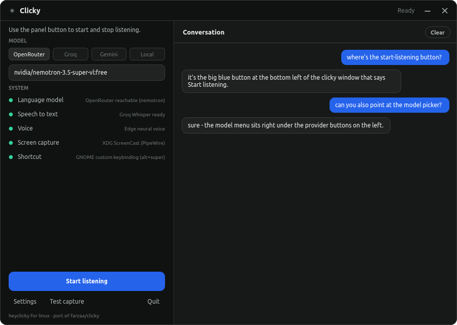

# heyclicky for Linux

A native Linux/Ubuntu port of [farzaa/clicky](https://github.com/farzaa/clicky) —
a push-to-talk AI companion that sees your screen, talks back, and glows around
the screen edges while it is working. When it explains where something is, a
pulsing ring marks the exact spot.

The original is a macOS menu-bar app. This port rebuilds the whole workflow with
Qt 6 and Python, and swaps the hosted Claude/AssemblyAI/ElevenLabs stack for
**Groq**, **Gemini** and **local Ollama** (`qwen2.5vl:7b`).



## What it does

Hold the shortcut, ask a question out loud, and Clicky:

1. records while you hold (the screen-edge glow pulses with your voice);
2. transcribes the audio;
3. captures **all** connected screens, cursor screen first;
4. streams an answer from OpenRouter, Groq, Gemini or Ollama;
5. speaks the answer with a natural voice;
6. parses a `[POINT:x,y:label]` tag and shows a pulsing ring on the button,
   menu or line of text it is talking about;
7. keeps the last ten exchanges so follow-up questions make sense.

The overlay is click-through, per-monitor, and never steals focus. Nothing is
captured until you finish speaking.

## Features

- Multi-monitor screen awareness, 1280px JPEGs, cursor screen marked primary.
- Streaming vision chat: OpenRouter (NVIDIA Nemotron 3.5 Super VL free) by
  default, plus Gemini (`2.5-flash`), Groq (`gpt-oss-20b`, text-only) or local
  Ollama (`qwen2.5vl:7b`).
- Answers stream into the chat and are spoken sentence by sentence, so audio
  starts before the model has finished writing.
- Speech-to-text: Groq Whisper, Gemini audio, or local `faster-whisper`.
- Speech: Edge TTS, Gemini TTS, Piper, or Speech Dispatcher.
- The original pointing grammar, including `:screenN` for other monitors.
- A soft audio-reactive glow around every screen edge while Clicky is active,
  plus a three-second pulsing ring on the element it points at.
- Tray panel split into controls (left) and a scrollable chat transcript
  (right), with provider/model picker and live health checks.
- Draggable frameless window, minimise-to-tray, and a top-bar tray indicator
  that shows ready/listening/thinking/answering and reopens the panel.
- Settings for keys, models, audio device, hotkey backend, capture backend.
- Ctrl+Alt+Space default shortcut, with configurable alternatives and no Fn dependency.
- Single-instance IPC plus CLI controls (`--toggle-listen`, `--show-panel`, …).
- `--doctor`, `--watch-keys` and `--capture-test` for diagnosing Linux quirks.
- No telemetry, no account, no hosted proxy.

## Requirements

- Ubuntu 22.04+ (or another modern Linux desktop), Python 3.10+.
- A microphone visible to ALSA/PulseAudio/PipeWire.
- `arecord` or `parec`, and `ffplay`/`paplay`/`aplay` for playback.
- On Wayland: `python3-gi` and `gstreamer1.0-pipewire` for ScreenCast-based
  screen awareness (GNOME/Plasma ask once which monitor to share). An Xorg
  session still gives the smoothest push-to-talk and capture.

```bash
sudo apt install python3 python3-venv alsa-utils ffmpeg libxcb-cursor0 \
                 python3-gi gstreamer1.0-pipewire
```

## Quick start

```bash
git clone <this-repo> heyclicky-linux
cd heyclicky-linux
./install.sh              # venv + desktop entry + launcher
heyclicky --doctor        # check providers, audio, capture and hotkeys
heyclicky
```

API keys can be supplied either in **Settings → Models** or in a `.env` file next to
the repo (copy `.env.example` to `.env`; `.env` is git-ignored). The app loads
`GROQ_API_KEY`, `OPENROUTER_GEMMA_API_KEY` and `GEMINI_API_KEY` from `.env` /
environment automatically, so no key has to be written to `config.json`.

Or run straight from the source tree:

```bash
python3 -m venv .venv
.venv/bin/pip install -e .
./run.sh
```

Open **Clicky** from the app grid, or use the tray icon. On first launch the
panel explains the privacy model and asks you to pick a provider.

### Provider setup

**Groq** (very fast, free tier available; text-only on current accounts)

```bash
export GROQ_API_KEY=gsk_...
# or paste it in Settings → Models
```

Default model: `openai/gpt-oss-20b`. Groq's remaining hosted models are
text-only, so screenshots are dropped and the prompt switches to text-only
answers; Whisper on Groq is still used for speech-to-text. For screen pointing
use OpenRouter, Gemini or Ollama.

**Gemini**

```bash
export GEMINI_API_KEY=AIza...
```

Default model: `gemini-2.5-flash`.

**Ollama** (fully local)

```bash
curl -fsSL https://ollama.com/install.sh | sh
ollama pull qwen2.5vl:7b
```

Select **Local** in the panel. The base URL defaults to
`http://127.0.0.1:11434`; set `OLLAMA_HOST` to change it. A text-only model such
as `qwen2.5:7b` also works, but screenshots are dropped and the prompt says so.

Keys can also be pasted in **Settings → Models**. They are written to
`~/.config/heyclicky/config.json` with mode `0600`; environment variables take
precedence.

## Using the shortcut

The shipped default is **Ctrl+Alt+Space**, with **Ctrl+Shift+Space** as the
fallback if Ctrl+Alt is already taken by another app. Ctrl+Alt+Space is free on
stock GNOME, KDE and XFCE and avoids the Super chords that GNOME reserves for
shell shortcuts (`Super+Space` switches input sources). Fn is avoided entirely
because firmware on most laptops never reports it to Linux.

| Session | Shortcut | Behaviour |
| --- | --- | --- |
| Xorg + input group | `Ctrl+Alt` | hold to talk |
| Xorg without input group | same | pynput fallback |
| Wayland / GNOME | `Ctrl+Alt` + `Space` | toggle: press to start, press again to send |
| Any | panel button | click **Start listening** |

You can change it under **Settings → Shortcuts & capture**. Good alternatives:
`Ctrl+Shift`, `Alt+Shift`, or `Super+Shift`. Avoid `Super+Space` (input source)
and modifier chords containing `Fn`.

> **Fn is usually invisible to Linux.** On the Lenovo IdeaPad 82KT the kernel
> never receives an Fn scancode — it is swallowed by the embedded controller, so
> `Fn+Super` arrives as a plain Super press and cannot be bound. Check your
> machine with `heyclicky --doctor` (watch for the `fn-key` line) or
> `sudo heyclicky --watch-keys` and press the chord.

For true hold-to-talk on Wayland, add yourself to the `input` group:

```bash
sudo usermod -aG input "$USER"
# log out and back in
```

The app installs a GNOME custom keybinding automatically when it falls back to
toggle mode. Change the combo, mode or backend in **Settings → Shortcuts &
capture**; the **Check Fn key** button tells you what your keyboard reports.
Full details: [docs/LINUX_NOTES.md](docs/LINUX_NOTES.md).

### First capture on Wayland

The first time Clicky looks at your screen, GNOME/Plasma shows a **Share your
screen** dialog. Select the monitor(s) Clicky should see and click **Share**.
The permission is stored as a restore token, so later captures are silent. If
the dialog is cancelled, press the shortcut again. To change the shared
monitor later, set `capture.backend` to `screencast` in Settings and remove
`capture.screencast_restore_token` from the config, or simply use Xorg.

### If Clicky cannot hear you

Run `heyclicky --doctor` and look at the `microphone-level` row. A muted or
very quiet input is the most common cause of empty transcripts. Raise the input
volume in **Settings → Sound**, then try again. Clicky also discards the
stream-start pop and lifts quiet recordings automatically, so it tolerates low
gain better than most apps, but a muted source still produces nothing.

## CLI

```text
heyclicky                     run the tray app
heyclicky --doctor [--json]   diagnose providers/audio/capture/hotkeys
heyclicky --watch-keys [N]    print key events for N seconds (use sudo for Fn)
heyclicky --capture-test      save /tmp/heyclicky-capture-N.jpg
heyclicky --show-panel        open the panel of a running instance
heyclicky --toggle-listen     start/stop listening in a running instance
heyclicky --start-listen      begin listening
heyclicky --stop-listen       finish listening
heyclicky --settings          open settings
heyclicky --quit              quit the running instance
heyclicky --provider ollama   override provider for this run
heyclicky --model qwen2.5vl:7b
heyclicky --config-dir DIR    alternate config directory
```

## Configuration

`~/.config/heyclicky/config.json` (or `$HEYCLICKY_CONFIG_DIR`):

| Section | Keys |
| --- | --- |
| `llm` | `provider` (`openrouter`/`groq`/`gemini`/`ollama`), `reasoning` (`off`/`low`/`model`), per-provider `api_key`, `base_url`, `model` |
| `llm.openrouter` | `api_key` (or `OPENROUTER_GEMMA_API_KEY`), `base_url`, `model` (default `nvidia/nemotron-3.5-super-vl:free`) |
| `llm.groq` | `api_key` (or `GROQ_API_KEY`), `base_url`, `model` |
| `llm.gemini` | `api_key` (or `GEMINI_API_KEY`), `base_url`, `model` |
| `llm.ollama` | `base_url`, `model`, `keep_alive` |
| `stt` | `provider` (`auto`/`groq`/`gemini`/`local`), `language`, `keyterms` |
| `tts` | `provider`, `voice`, `volume`, `enabled` |
| `capture` | `backend` (`auto`/`screencast`/`portal`/`x11`/`gnome`/`cli`), `max_dimension`, `jpeg_quality`, `screencast_restore_token` |
| `hotkey` | `backend` (`auto`/`evdev`/`pynput`/`gnome`/`manual`), `combo`, `mode` (`auto`/`hold`/`toggle`), `fallback_combo` |
| `audio` | `input_device`, `sample_rate`, `max_seconds` |
| `ui` | `edge_glow`, `start_minimized`, `panel_width`, `onboarding_completed` |

### If replies feel slow

Clicky streams the model's answer into the chat and starts speaking as soon as
the first sentence arrives, so time-to-first-sound is much shorter than
time-to-last-token. Three things can still make it feel slow:

1. **OpenRouter's free tier is shared and rate-limited.** A free `:free` model
   can take five to ten seconds to reply, return an empty answer, or return
   HTTP 429 (the free daily quota is 50 requests without credits). `--doctor`
   and the chat banner show the exact reason. Adding $10 of OpenRouter credits
   unlocks 1,000 free requests/day; a free Gemini API key is an even faster
   vision option (**Settings → Models → Gemini**).
2. **Reasoning models think before they answer.** Some models spend the whole
   token budget on hidden reasoning and return nothing. Clicky sends
   `reasoning: {"enabled": false}` by default; change it under
   **Settings → Models → Model reasoning** if you want deeper answers and do
   not mind the wait.
3. **Screenshots cost tokens.** A smaller `capture.max_dimension` uploads
   faster; the default 1280 px is a good balance for reading UI text.

## How it works

The short version: a Qt GUI thread owns the panel, tray and overlay; one worker
thread per utterance runs STT → capture → LLM → TTS; Qt signals carry results
back. Screen coordinates are scaled from screenshot pixels to the target
monitor's logical geometry, and a per-monitor overlay window paints the edge
glow and the pointing ring without ever taking focus.

- [Architecture](docs/ARCHITECTURE.md) — modules, state machine, threading,
  provider interface, IPC.
- [Reverse engineering report](docs/REVERSE_ENGINEERING.md) — every behaviour
  traced to upstream `file:line`, plus the macOS→Linux difference table.
- [Linux notes](docs/LINUX_NOTES.md) — Xorg vs Wayland, hotkeys, portals,
  Ollama, audio, troubleshooting.
- [Landing page](site/index.html) — a self-contained, dependency-free overview
  you can open straight from disk.

## Testing

```bash
.venv/bin/ruff check src tests
QT_QPA_PLATFORM=offscreen .venv/bin/pytest
```

The suite covers point parsing, geometry and clamping, config persistence,
provider payloads, glow math, hotkey combos and an end-to-end pipeline run with
fake capture/STT/LLM/TTS backends.

## What is different from the macOS app

Ported: the prompt and voice, the four-state flow, multi-screen capture,
`[POINT:…]` grammar, ten-exchange memory, cancellation, the always-mapped
click-through overlay, the edge glow and the pointing ring.

Not ported: the onboarding video/music, email capture, PostHog analytics, and
the hosted proxy with hidden keys. On Linux the app talks to providers directly,
so keys are user-supplied. `[POINT:none]` still behaves exactly like upstream.

## Credits and licence

- Original app, prompt and interaction design: **Farza** —
  [farzaa/clicky](https://github.com/farzaa/clicky), MIT.
- This Linux port is unofficial and MIT licensed; see [LICENSE](LICENSE).
- Groq, Gemini and Ollama are trademarks of their respective owners.
